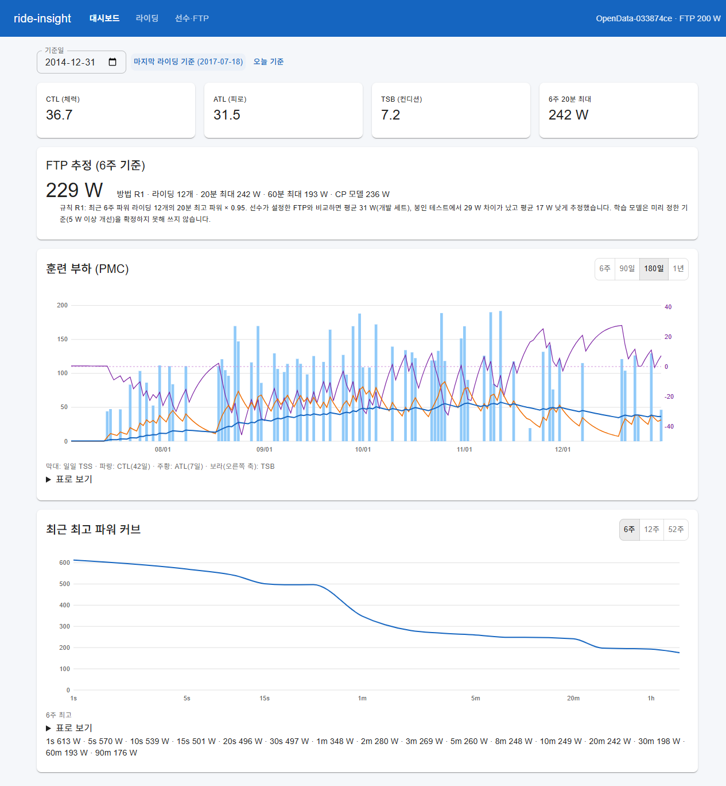
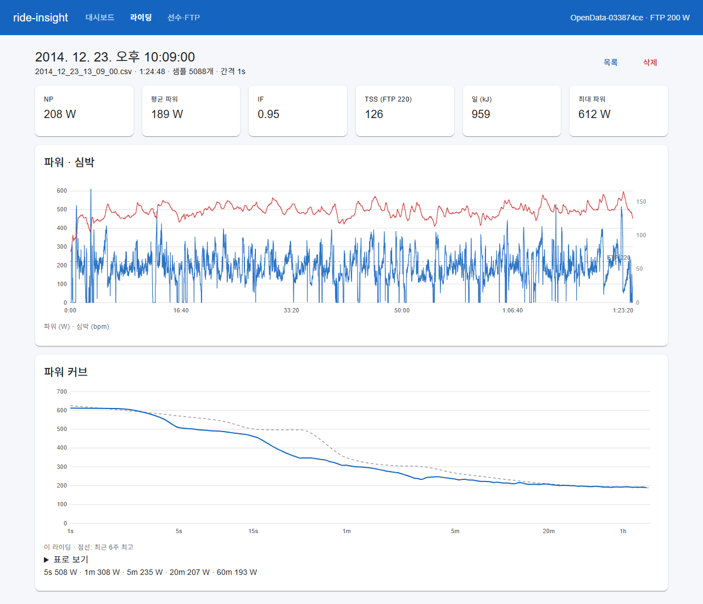
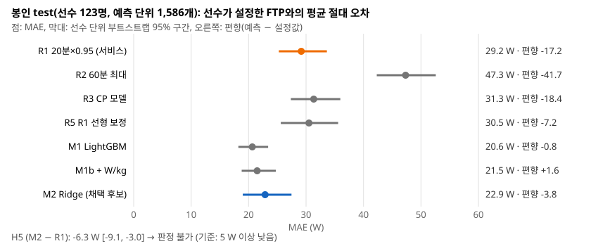

# ride-insight

사이클링 파워미터 데이터(FIT 파일)를 받아 훈련 지표(NP·IF·TSS, 파워 커브, CTL/ATL/TSB)를 계산하고 FTP를 추정하는 웹 서비스다. 서버는 Kotlin(Spring Boot 4.1, PostgreSQL), 모델 학습·평가는 Python, 화면은 React + D3로 만들었다.

점수 경쟁 대신 **미리 정한 규칙으로 재는 것**에 집중했다. 지표 구현이 다른 구현(GoldenCheetah)과 얼마나 일치하는지, 어떤 FTP 추정 방법이 실제 선수 데이터에서 가장 잘 맞는지, 기기마다 다른 FIT 파일과 변조된 파일을 서버가 어떻게 처리하는지를 규칙을 먼저 커밋한 뒤 쟀다. 그리고 AI 코딩 도구(Claude Code, Codex)가 만든 코드를 어떤 절차로 검증했고 무엇이 잡혔는지를 기능마다 남겼다.

- 계획: [docs/plan.md](docs/plan.md)
- 측정 규칙과 결과: [docs/experiments.md](docs/experiments.md)
- 저장 모델·API·완료 기준: [docs/api.md](docs/api.md)
- AI가 만든 코드의 검증 기록: [docs/ai-verification.md](docs/ai-verification.md)

## 한눈에
| 질문 | 답 (미리 정한 규칙으로 판정) |
|---|---|
| 직접 구현한 NP·MMP·TSS는 GoldenCheetah와 얼마나 일치하나 | 봉인 세트(선수 100명, 라이딩 32,907개) 중 1초 기록 31,150개에서 NP 99.61% [99.54, 99.68], 16구간 MMP 99.65% [99.60, 99.71]가 1 W 안에서 일치. TSS는 GoldenCheetah가 실제로 쓴 임계값으로 다시 계산하고 수동 입력(정수)·부재 TSS를 뺀 28,337개에서 99.97% [99.94, 99.99]가 0.5 안에서 일치(세 가설 모두 지지). NP 차이가 가장 큰 5건은 메타데이터는 파워가 있다는데 CSV의 파워 열이 빈 라이딩이었고, 개발 세트에서 분류한 불일치는 타임스탬프가 1.00·1.03초로 흔들리는 파일 같은 입력 쪽 문제였다(봉인 세트의 불일치 전체를 분류하지는 않았다) |
| 기록 간격이 1초가 아니면 얼마나 흔들리나 | 5초 기록은 그대로 잘 맞고(비1초 전체 96.4%), 1.26초처럼 흔들리는 간격만 GoldenCheetah의 recIntSecs를 CSV에서 복원할 수 없어 어긋난다. "5%p 이상 낮다"는 가설은 기각 |
| GoldenCheetah의 TSS를 그대로 믿어도 되나 | 아니다. 라이딩의 10~13%는 IF·TSS에 `cp_setting`(CP)이 아닌 존 설정의 FTP가 쓰였고, 정수 TSS(수동 입력으로 추정)는 계산값과 거의 다 어긋났으며, IF는 있는데 TSS가 없는 라이딩도 있었다. 이 셋을 구분해 비교해야 구현 차이가 보인다 |
| 업로드한 FIT의 지표는 기기 값과 맞나 | Garmin Edge 810 라이딩: NP 300.6 W(기기 301), TSS 118.9(기기 118.7), IF 0.954(기기 0.956) |
| 최근 6주로 FTP를 얼마나 맞히나 | 봉인 test(선수 123명, 예측 단위 1,586개)에서 흔한 규칙 "20분 최대 × 0.95"는 선수가 설정한 FTP와 평균 29.2 W [25.3, 33.6] 차이, 그것도 17 W **낮게**(과대 추정한다는 가설은 기각). 학습한 모델(LightGBM 20.6 W, Ridge 22.9 W)이 더 가깝지만, 미리 정한 "5 W 이상 개선"을 구간으로 확정하지 못해(채택 후보 Ridge: −6.3 W [−9.1, −3.0]) 규칙대로 **서비스는 그 규칙을 그대로 쓰고 오차를 함께 보여 준다** |
| 변조·손상 FIT와 보안 스캔 | 변조 7종(크기 필드 조작, CRC, 정의 없는 데이터, 역행 타임스탬프, 10 MB 초과)이 모두 미리 적은 상태 코드를 돌려주고(CRC 변조는 저장하되 `crcValid=false`로 표시, 나머지는 400·413으로 거절) 500은 없음. OWASP ZAP: 1차에서 **존재하지 않는 경로에 500을 돌려주던 버그**와 보안 헤더 누락을 잡아 고쳤고, 2차는 High·Medium 0건(남은 Low 1건은 숫자 배열을 타임스탬프로 본 오탐). 동시 업로드 10개의 p95는 첫 회차(JIT 워밍업) 0.64 s, 이후 0.33~0.36 s, 5xx 없음. 2026-10-15에는 구조는 올바르지만 메시지를 아주 많이 넣은 조작 파일을 재서, 4 MB 파일 하나가 힙 821 MB(입력의 205배)를 붙잡아 힙 512 MB 서버를 OutOfMemoryError(500)로 만드는 것을 확인하고 고쳤다(담는 필드 제한, record 열 저장, record 50만 개 상한은 413). 고친 뒤 같은 파일들을 동시 5개씩 올려도 5xx·OOM 0건 |

첫 두 줄의 일치율은 수정 전 비교 코드로 낸 값이다. 2026-10-13에 비교 코드가 우리 구현과 GoldenCheetah가 둘 다 0(3000 W 가드)인 쌍을 불일치로 센 것을 찾아 고쳤고, 미리 정한 규칙대로 개발 세트에서만 다시 쟀다. 바뀐 것은 16구간 MMP 일치율뿐이고(99.96% → 99.98%) NP·TSS·비1초 결과와 판정은 그대로였다. 봉인 결과는 규칙대로 그대로 둔다([docs/experiments.md](docs/experiments.md) 규칙 변경 9, 1단계 "사후 수정(개발 세트) 결과").

## 화면과 그림


대시보드(OpenData 선수 1명을 `importOpenData`로 넣고 기준일 2014-12-31, PMC 180일). FTP 추정 카드는 규칙 R1과 그 규칙의 측정 오차를 함께 보여 준다. 그래프마다 화면 읽기용 한국어 요약이 있고 '표로 보기'로 값을 펼칠 수 있다.





FTP 추정 3단계의 봉인 test 결과(`reports/ftp/test.json`의 수치만 그림으로 옮김, `python -m ride_insight_ml.figures`). 학습 모델이 R1보다 6~9 W 낮지만 미리 정한 "5 W 이상 개선"을 구간으로 확정하지 못해 서비스는 R1을 쓴다.

## 선행 연구와의 차이
같은 GoldenCheetah OpenData로 FTP를 예측한 연구가 있다: Stockwell·Corradini, "A Machine Learning Approach to Predict Cyclists' Functional Threshold Power", IDEAL 2023(LNCS, pp. 368–380, [doi:10.1007/978-3-031-48232-8_34](https://doi.org/10.1007/978-3-031-48232-8_34)). 원문과 초록은 열람하지 못했고(출판사 페이지가 막혀 있고 메타데이터 API에도 초록이 없다), 아래는 그 연구를 소개한 기사([Escape Collective, 2023-12-08](https://escapecollective.com/hour-of-power-do-we-need-a-better-way-to-benchmark-fitness/))에서 확인한 범위다.

- 기사에 따르면 그 연구는 약 126만 개 운동을 쓰고, 16~100세·체중 50~150 kg·라이딩 30회 이상인 선수로 거르고, **선수의 데이터 안 최고 60분 파워를 "실제 FTP"로 삼았다**. 그 기준에서 "20분 최대 × 0.95"는 FTP를 **과대** 추정했고(평균 최고 20분 285.22 W, 평균 실제 FTP 247.39 W라 약 86%가 더 맞는다고 제안), 가중 선형 회귀 모델은 과대 추정이 덜했다
- 이 저장소는 **선수가 GoldenCheetah에 설정해 둔 FTP**(라벨 L_FTP)를 정답으로 두고, 예측 단위마다 **최근 6주 창**만 본다. 그래서 같은 R1이 −17.2 W로 **과소** 추정이 나왔다(H6 기각). 방향이 반대인 것은 정답 정의가 다르기 때문으로 보인다: 커밋된 보고서의 두 편향을 빼면 R1은 같은 6주 창의 최고 60분 파워(R2, 편향 −41.7 W)보다 평균 약 24.5 W 높다. 곧 "창 안 최고 60분 파워"를 정답으로 삼으면 이 데이터에서도 R1은 과대 추정이라는 선행 연구와 같은 방향이다. 다만 이 24.5 W는 보고서 값의 산술이고(R2가 없는 단위 5개 때문에 두 편향의 단위 수가 1,586과 1,581로 다르다) 봉인 test를 다시 계산하지 않았으며, 그 연구의 기준은 6주 창이 아니라 데이터 전 기간의 최고 기록이라 수치를 직접 비교할 수는 없다
- 어느 쪽 정답도 실험실 측정(젖산 역치 등)이 아니다. 이 저장소가 결과를 "선수 설정값과의 차이"로만 말하는 이유다

## 구조
| 폴더 | 내용 |
|---|---|
| `server/` | Kotlin 2.3 + Spring Boot 4.1 (JDK 21). `metrics/` 순수 지표 함수(NP·IF·TSS·MMP·훈련 부하·FTP 규칙), `fit/` 직접 쓴 FIT 디코더, `storage/` JdbcClient + Flyway(배열 컬럼), `service/`·`api/` REST, `tools/` OpenData 대조·가져오기 |
| `ml/` | Python 3.11 (uv). OpenData 표본·다운로드·인덱스, 파리티 분석, FTP 추정 실험, 부하 시험 |
| `web/` | React 19 + TypeScript (Vite), MUI, React Query, Zustand, D3 |
| `zap/` | OWASP ZAP 자동화 계획과 실행 스크립트 |
| `manifests/` | 데이터 표본·분할·파리티 선수 목록 |
| `reports/` | 측정 결과(JSON·Markdown) |
| `compose.yaml` | PostgreSQL + 서버 + 웹 전체 스택 |

## 실행
```bash
# 전체 스택 (Docker): 웹 http://localhost:8081, API http://localhost:8080
docker compose up --build

# 개발: PostgreSQL은 server/compose.yaml로 bootRun이 자동으로 띄운다 (호스트 55443)
cd server && ./gradlew bootRun
cd web && npm install && npm run dev      # http://localhost:5173, /api는 8080으로 프록시
```

화면에서 선수를 만들고 FTP를 등록한 뒤 FIT 파일을 올리면 지표·파워 커브·훈련 부하·FTP 추정이 나온다. 샘플 FIT는 `server/src/test/resources/fit/`에 있다(python-fitparse 테스트 파일, MIT).

## 테스트
```bash
cd server && ./gradlew test           # 단위 + Testcontainers(PostgreSQL 16) 통합 테스트. Docker 필요
cd ml && uv sync && uv run pytest && uv run ruff check .
cd web && npm run lint && npm test && npm run build
```

## 데이터
- **GoldenCheetah OpenData** — [OSF osf.io/6hfpz](https://osf.io/6hfpz) (DOI 10.17605/OSF.IO/6HFPZ), **CC0 1.0**. GoldenCheetah 사용자 6,613명이 공유한 익명 라이딩(초 단위 파워·심박·케이던스·거리·고도, GPS 없음). 이 저장소에는 데이터를 넣지 않고 표본 목록(800명, 선수 id의 SHA-256 순서)과 다운로드 스크립트만 둔다
  ```bash
  cd ml
  uv run python -m ride_insight_ml.opendata download --sample ../manifests/opendata_sample.json --dest ../data/opendata
  uv run python -m ride_insight_ml.rides --zips ../data/opendata --out ../data/opendata_index
  ```
- 메타데이터의 `date`는 UTC이고 CSV 파일명은 기기 현지 시각이라 이름이 그대로 맞는 라이딩은 일부뿐이다. 15분 배수 오프셋과 `workout_time` 일치로 짝지었다(`ml/src/ride_insight_ml/rides.py`). 내보내기 JSON 두 건은 따옴표·제어 문자가 이스케이프되지 않아 수리해서 읽는다
- **FIT 디코더는 직접 썼다.** Garmin FIT SDK의 라이선스가 공개 저장소의 의존성으로 두기에 불확실해, 공개 프로토콜 설명과 python-fitparse(MIT)의 프로필 번호로 구현하고 fitparse의 디코딩 결과(레코드 31,156개)와 대조하는 테스트를 둔다

## 측정 방식
- 후보와 판정 규칙을 `docs/experiments.md`에 먼저 적고 커밋한 뒤 개발 세트에서 구현을 맞추고, 봉인 세트는 단계가 끝날 때 한 번만 잰다. 봉인 결과를 보고 고치지 않는다
- 선수 단위로 train 60 / dev 20 / test 20을 나눈다(SHA-256). 구간은 라이딩 또는 선수 단위 부트스트랩 95%
- 규칙을 바꾸면 이유와 시점을 "규칙 변경" 절에 남긴다(1단계에서 4번: 선수 조건 완화, TSS 비교 기준을 GC가 실제로 쓴 임계값으로, 수동 입력 TSS 제외, GC에 없는 TSS 제외)

## AI 도구와 검증
Claude Code가 설계·구현·측정을, Codex가 독립 검토(읽기 전용 정적 검토)를 맡았다. 두 도구가 만든 것과 잡힌 실수는 [docs/ai-verification.md](docs/ai-verification.md)에 기능마다 적었다. 예: fitparse 대조가 잡은 FIT 디코더 버그 2개(필드 번호, 개발자 필드 정의 크기), 통합 테스트가 잡은 PgJDBC `float4` 읽기 오류, Codex 검토 세 번 35건(봉인 규칙의 누수 허용, NaN 전파, 체인 블록별 메시지 상한, 신선 라벨 정의 불일치, 측정 조건 위반 등).

## 한계
- 인증이 없다(로컬 데모). 선수 id를 아는 사람은 누구나 읽고 쓸 수 있다
- FTP 라벨(선수가 설정한 값)은 정답이 아니다. 결과는 "선수 설정값과의 차이"로만 말한다
- OpenData는 GoldenCheetah 사용자의 데이터라 일반 사용자와 분포가 다를 수 있다
- 타임스탬프가 흔들리는 파일(1.03초 등)은 GoldenCheetah의 기록 간격을 복원할 수 없어 MMP·TSS가 1~3% 어긋난다
- Strava·Garmin Connect 연동은 없다(FIT 업로드만)
- 날짜(PMC의 하루, 활동에 적용할 FTP, 기준일)는 선수 시간대(기본 Asia/Seoul)로 센다. 여행 중 다른 시간대에서 탄 라이딩도 선수 시간대의 날짜로 묶인다(FIT의 현지 시각 정보는 쓰지 않는다)
